<p align="center">
  <a href="https://erwin50331.github.io/svg-scene-atlas/">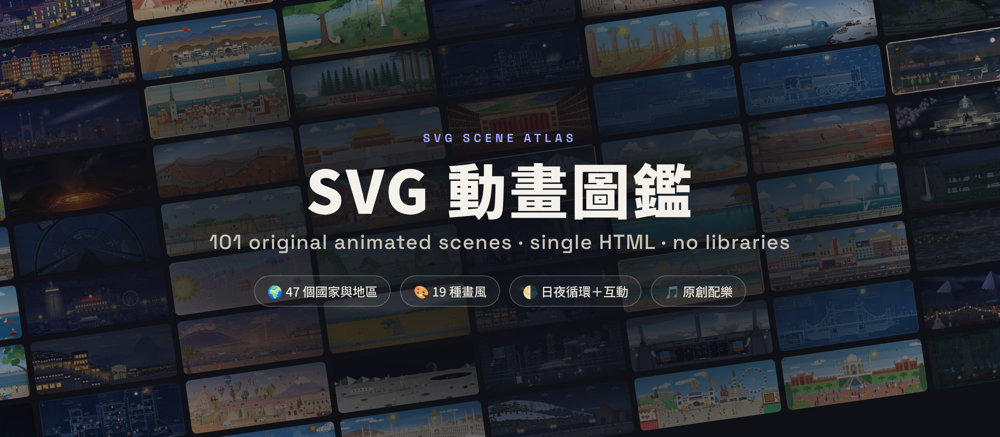</a>
</p>

<h1 align="center">SVG 動畫圖鑑 · SVG Scene Atlas</h1>

<p align="center">
  <b>101 組原創寬幅動畫場景，從里斯本的坡道電車到月球南極的地球升起。</b><br>
  每一組都是一個 HTML 檔，下載後直接打開就會動，也能放進你的網頁。
</p>

<h2 align="center">
  <a href="https://erwin50331.github.io/svg-scene-atlas/">🌐 逛逛網站 →</a>
</h2>

<p align="center">
  <a href="#-怎麼用">⬇️ 怎麼用</a> ·
  <a href="#-作者精選">⭐ 作者精選</a> ·
  <a href="#-授權">📜 授權</a>
</p>

<p align="center">
  <picture></picture>
  <picture></picture>
  <picture></picture>
  <picture></picture>
  <picture></picture>
  <picture></picture>
</p>

<p align="center">
  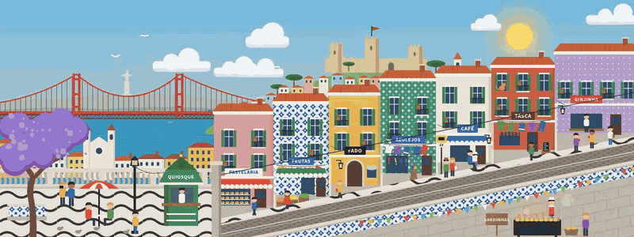<br>
  <a href="https://youtu.be/a6wIkbDMGFw">▶ 花 40 秒，看它們動起來</a>
</p>

---

## ✨ 這是什麼

一個收藏 **SVG 場景動畫** 的小圖鑑。每一組場景都畫了一個真實地點（或想像中的地方），而且會動：

- **日夜循環**：白天的人潮、傍晚的夕陽、夜裡的燈火，會自己慢慢轉換
- **點了有反應**：畫面裡的人物、車船、動物都能點，大部分場景還有一場可以觸發的「秀」（水舞、煙火、熱氣球升空……）
- **原創配樂與音效**：用瀏覽器即時合成，不載入任何音檔，預設靜音
- **19 種畫風**：剪紙層疊、CGI 電影質感、浮世繪、水彩、藍晒圖、羊毛氈、彩繪玻璃……
- **一個檔案搞定**：純 SVG＋原生 JavaScript，沒有框架、沒有外部函式庫
- **減少動態**：支援 `prefers-reduced-motion`，喜歡少一點動態的人也看得舒服

## ⭐ 作者精選

| | | |
|:-:|:-:|:-:|
| <a href="https://erwin50331.github.io/svg-scene-atlas/#sc-19">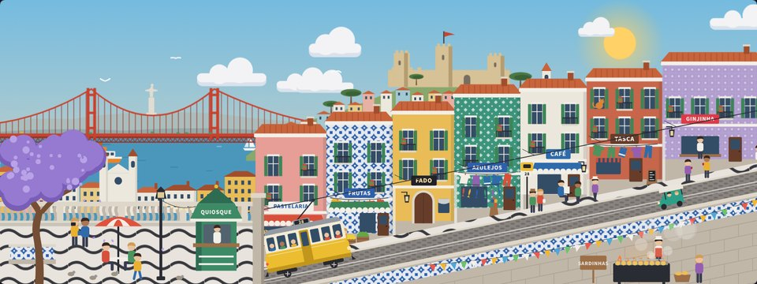</a><br>**里斯本坡道電車**<br><sub>扁平插畫 · 葡萄牙</sub> | <a href="https://erwin50331.github.io/svg-scene-atlas/#sc-56">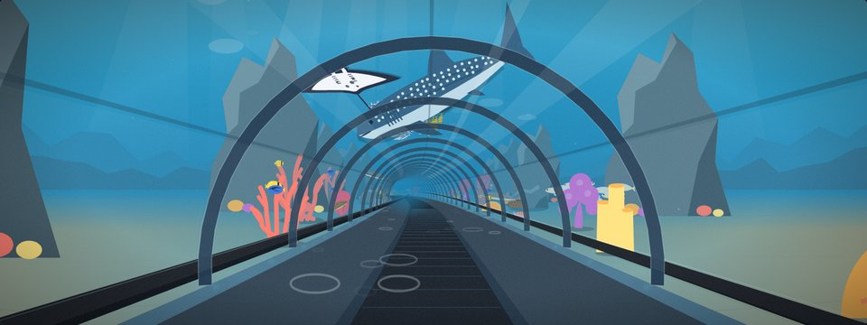</a><br>**水族館海底隧道的鯨鯊巡游**<br><sub>剪紙層疊 · 🎥 第一視角</sub> | <a href="https://erwin50331.github.io/svg-scene-atlas/#sc-73">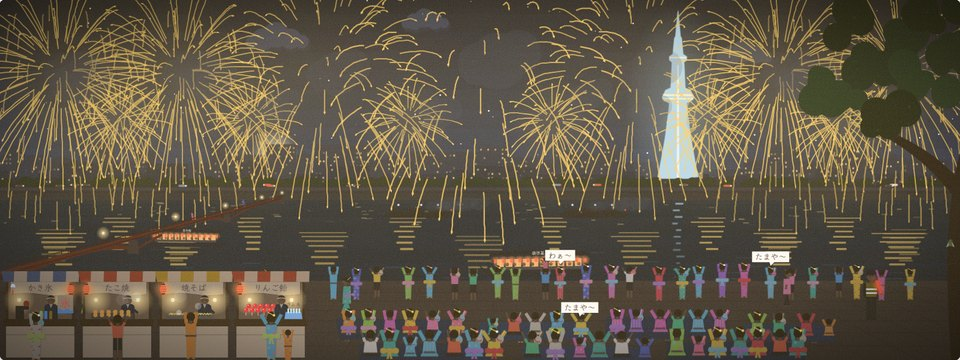</a><br>**東京隅田川的花火大會**<br><sub>剪紙層疊 · 日本</sub> |
| <a href="https://erwin50331.github.io/svg-scene-atlas/#sc-84">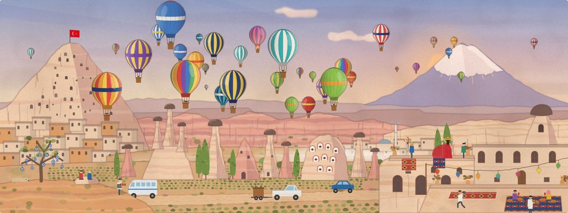</a><br>**卡帕多奇亞的熱氣球日出**<br><sub>水彩感 · 土耳其</sub> | <a href="https://erwin50331.github.io/svg-scene-atlas/#sc-33">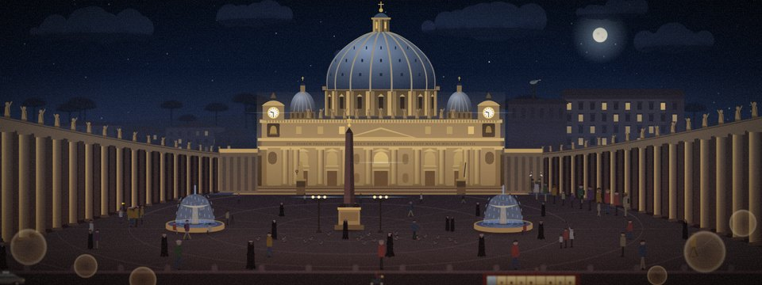</a><br>**梵蒂岡聖伯多祿廣場**<br><sub>CGI 電影質感 · 梵蒂岡</sub> | <a href="https://erwin50331.github.io/svg-scene-atlas/#sc-101">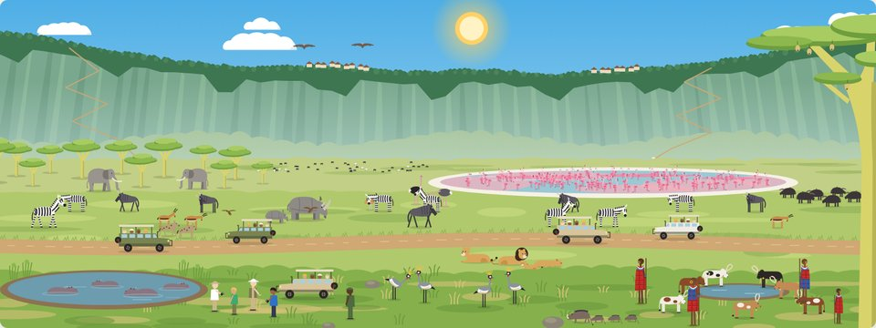</a><br>**恩格羅恩格羅火山口的紅鶴湖**<br><sub>扁平插畫 · 坦尚尼亞</sub> |
| <a href="https://erwin50331.github.io/svg-scene-atlas/#sc-94">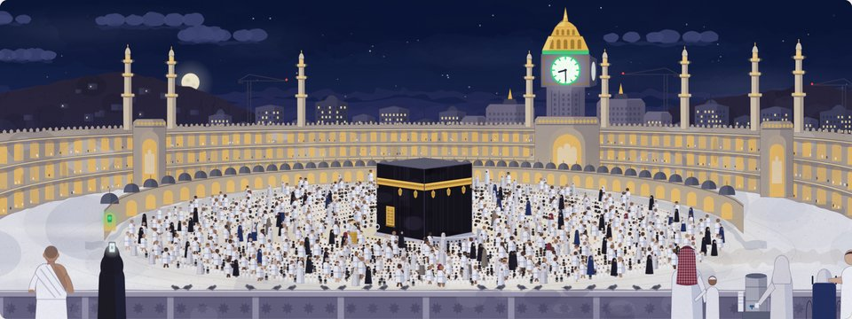</a><br>**麥加天房的萬人繞行**<br><sub>水彩感 · 沙烏地阿拉伯</sub> | <a href="https://erwin50331.github.io/svg-scene-atlas/#sc-32">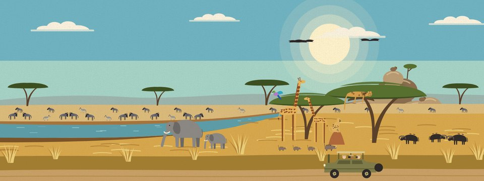</a><br>**坦尚尼亞草原大遷徙**<br><sub>扁平插畫 · 坦尚尼亞</sub> | <a href="https://erwin50331.github.io/svg-scene-atlas/#sc-43">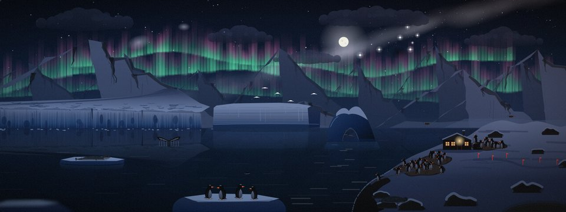</a><br>**南極半島的冰山與企鵝**<br><sub>CGI 電影質感 · 南極</sub> |

<p align="center"><a href="https://erwin50331.github.io/svg-scene-atlas/"><b>看全部 101 組 →</b></a></p>

## 🎨 19 種畫風

| 畫風 | 組數 | | 畫風 | 組數 |
|---|:-:|---|---|:-:|
| 剪紙層疊 | 16 | | 線稿 | 3 |
| CGI 電影質感 | 15 | | 極簡幾何 | 3 |
| 扁平插畫 | 13 | | 刺繡布藝 | 3 |
| 水彩感 | 9 | | 黏土定格 | 3 |
| 浮世繪色塊 | 6 | | 羊毛氈 | 3 |
| 霓虹夜景 | 5 | | 像素風 | 2 |
| 復古石版海報 | 5 | | 彩繪玻璃 | 2 |
| 藍晒圖 | 5 | | 墨水畫 | 2 |
| 印象派 | 4 | | 立體派、3D 說明圖 | 各 1 |

## ⬇️ 怎麼用

**1. 下載**：在網站點開任一組，按「下載」。有兩種版本：

| 版本 | 內容 | 適合 |
|---|---|---|
| 純插畫版 | 只有動畫畫面，自動日夜循環，畫面裡的點擊互動保留 | 放進網頁當主視覺、當桌布 |
| 完整版 | 多了日夜切換、表演按鈕與互動說明 | 自己玩、展示 |

下載前可以勾選要不要「點擊音效」和「背景配樂」。

**2. 打開**：用瀏覽器直接打開 HTML 檔就會動。

**3. 放進你的網頁**：

```html
<iframe src="SC-19-lisbon-tram-flat.html"
        style="width:100%;aspect-ratio:8/3;border:0"
        title="里斯本坡道電車"></iframe>
```

**4. 換顏色**：打開檔案，最上面的 `:root` 區塊就是全部顏色，白天與夜晚各一組。

**5. 自己做一組**：每組都有一段「Prompt」，複製後貼到你自己的 Claude 對話，就能生成類似的場景，或換成你想要的地點與風格。網站不會呼叫任何 AI 服務。

## 🛠 專案結構

```
index.html            網站首頁
assets/style.css      網站樣式（色票在最上面）
assets/app.js         網站程式（篩選、預覽、下載、複製 Prompt）
data/scenes.js        全部場景資料，新增場景只改這裡
scenes/               場景完整版（SC-編號-代稱.html）
scenes/pure/          純插畫版，由 tools/make-pure.py 產生
thumbs/               預覽縮圖（白天／夜晚各一張，960×360）
tools/make-pure.py    產生純插畫版的小工具
```

純靜態網站：沒有伺服器、沒有資料庫、不需要任何 API 金鑰，也沒有建置步驟。本機預覽：

```bash
python3 -m http.server 8000
# 打開 http://localhost:8000
```

<details>
<summary><b>新增一組場景</b></summary>

1. 把場景 HTML 放進 `scenes/`。
2. 截兩張 960×360 的縮圖（白天、夜晚）放進 `thumbs/`，例如 `sc-102-day.jpg`、`sc-102-night.jpg`。
3. 在 `data/scenes.js` 的 `SCENES` 陣列加一筆，欄位說明寫在檔案最上面。
4. 在根目錄執行 `python3 tools/make-pure.py`，產生純插畫版。

卡片、篩選、統計數字與 Prompt 都會自動產生。

</details>

<details>
<summary><b>自己架一份（GitHub Pages）</b></summary>

1. Fork 這個 repo。
2. 進 **Settings → Pages**，Source 選 **Deploy from a branch**，Branch 選 `main`、資料夾選 `/ (root)`。
3. 約一分鐘後網站會出現在 `https://你的帳號.github.io/repo名稱/`。
4. 選用設定都在 `data/scenes.js` 的 `SITE`：
   - `repo`：repo 網址，頁首會出現 GitHub 連結。
   - `contact`：[Formspree](https://formspree.io) 表單網址，開啟「聯絡」表單。收件信箱只存在 Formspree 後台。
   - `analytics`：[GoatCounter](https://www.goatcounter.com) 代碼，開啟不用 cookie、不追蹤個人的統計。留空就完全不載入。

</details>

## 🤝 製作方式

場景由作者構想、選題，一輪一輪看成品、提出修改；SVG 繪製、動畫、配樂與互動程式由 [Claude](https://claude.ai) 撰寫。這個網站本身也是和 Claude 一起做的。

所有場景都是原創，不使用任何既有角色、品牌或商標。

## 📜 授權

- **程式碼**：MIT（見 [`LICENSE`](LICENSE)）
- **圖像與場景設計**：CC BY 4.0（見 [`LICENSE-ARTWORK.md`](LICENSE-ARTWORK.md)），歡迎分享、改作、商用，請標註「SVG 動畫圖鑑」並附上網址
- **導覽影片配樂**：[YouTube 導覽影片](https://youtu.be/a6wIkbDMGFw)的背景音樂來自 Artlist，依 Artlist 授權使用，不在 CC BY 4.0 範圍內，請勿單獨擷取或再利用；場景裡的原創配樂不受此限

---

<p align="center">
  喜歡的話，幫我按一顆 ⭐ 吧！你的每一顆星星，都是我做下一組的小小動力 ✨
</p>

<details>
<summary><b>English</b></summary>

**SVG Scene Atlas** is a collection of 101 original, animated, widescreen (1600×600) SVG scenes, from Lisbon's hillside trams to an Earthrise over the lunar south pole. Each scene is a single self-contained HTML file (SVG + vanilla JavaScript, no libraries) with a day/night cycle, clickable characters, a triggerable "show", and optional procedurally generated music. 19 art styles, 47 countries and regions.

Download any scene from the [website](https://erwin50331.github.io/svg-scene-atlas/), open it in a browser, or drop it into your page with an `<iframe>`. Code is MIT; artwork is CC BY 4.0. Scenes were conceived and directed by the author and built with [Claude](https://claude.ai).

</details>
